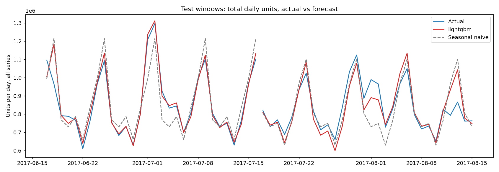
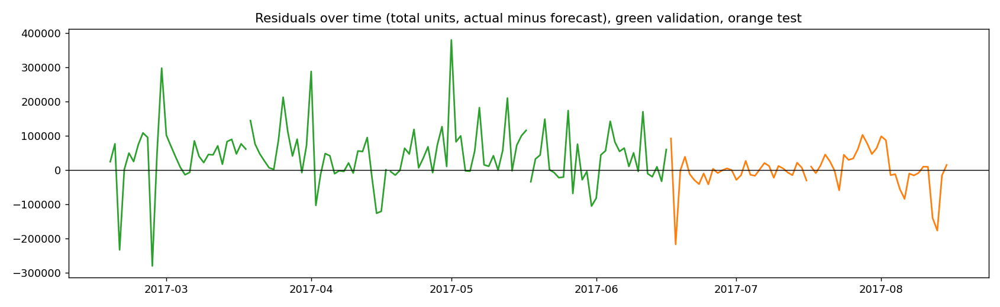
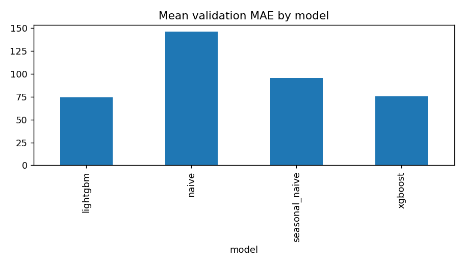
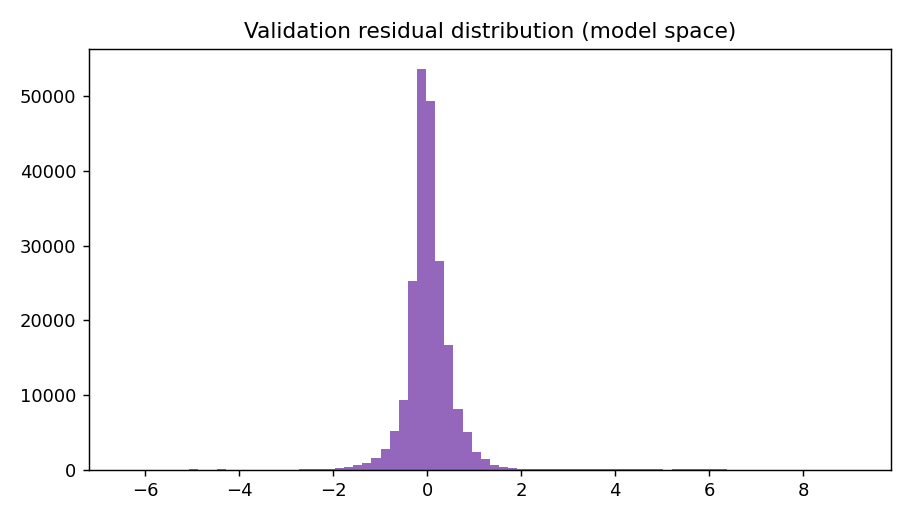
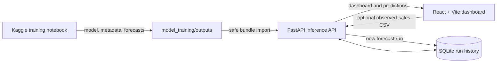

# Retail Demand Forecasting

A complete retail demand forecasting application for forecasting daily sales by store and product family. It combines a Kaggle training notebook, chronological model evaluation, saved-model inference through FastAPI, SQLite run history, and an interactive React dashboard.

## Highlights

- Generate recursive 7-, 14-, or 30-day predictions with a saved LightGBM or XGBoost model.
- Add newer daily sales observations through a guided CSV template.
- View historical sales, forecast totals, prediction intervals, a 7-day rolling mean, and category-level demand signals.
- Compare held-out model metrics with naive and seasonal-naive baselines.
- Review family growth and decline, low forecast volumes, volatile store/family series, evaluation charts, and model metadata.
- Download the full store/family forecast and interval bounds as a CSV.
- Reproduce training, EDA, validation, test evaluation, and model exports from the Kaggle notebook.

## Demo video


## Notebook output figures

The images below are produced by the training notebook and stored in `model_training/outputs/figures/`.

### Held-out actuals and forecasts



### Residuals over time



### Validation model comparison



### Residual distribution



## Dataset

The notebook uses Kaggle's *Store Sales — Time Series Forecasting* competition dataset. The training data contains 3,000,888 rows and six columns, covering 54 stores, 33 product families, and 1,782 store/family series from 2013-01-01 through 2017-08-15. The target is daily sales units.

The [Kaggle data page](https://www.kaggle.com/competitions/store-sales-time-series-forecasting/data) identifies the dataset as subject to the [competition rules](https://www.kaggle.com/competitions/store-sales-time-series-forecasting/rules). The repository does not include the raw competition files.

The notebook profiles row and column counts, nulls, duplicate rows and keys, date coverage, series counts, missing calendar dates, and target statistics. Dates absent across all stores are treated as closures; missing date/entity cells are filled with zero. Unusual demand spikes are flagged for review and retained rather than automatically removed. The generated cleaning log, EDA summary, and data dictionary document the processing decisions.

See [Data Dictionary](docs/data_dictionary.md) for source fields, engineered features, and output columns.

## Analysis and forecasting method

The notebook explores the aggregate daily demand trend and rolling average, weekday/month/year patterns, sales distribution, calendar heatmap, product-family and store totals, daily outlier flags, and weekly additive decomposition. It also charts held-out actuals versus forecasts, residuals over time, residual distribution, and validation MAE.

The forecasting pipeline:

1. Builds daily series for each store and family in chronological order.
2. Adds lag features at 1, 7, 14, and 28 days; past-only rolling means and standard deviations at 7, 14, and 28 days; calendar features; and static store/family context.
3. Compares a last-value naive forecast, weekly seasonal naive, pooled LightGBM, and pooled XGBoost.
4. Selects between boosted models by mean rank of MAE, RMSE, and sMAPE on four chronological validation windows.
5. Evaluates once on two later, held-out 30-day windows.
6. Fits the selected model on available history, then recursively forecasts each next day. Predicted values feed the future lag and rolling features.
7. Derives p10/p90 forecast bounds from validation residual quantiles by forecast step.

Future promotions are excluded because they are not available for the forecast period. Deep learning and per-series ARIMA fits are not used: the pooled tree models handle shared calendar and store/family context across the many related series.

## Evaluation results

The supplied final run selected LightGBM on validation. Held-out test results are:

| Model | MAE ↓ | RMSE ↓ | sMAPE ↓ | RMSLE ↓ |
|---|---:|---:|---:|---:|
| LightGBM | 62.82 | 240.82 | 55.84% | 0.438 |
| XGBoost | 65.81 | 256.32 | 52.40% | 0.442 |
| Seasonal naive (7-day) | 78.89 | 309.59 | 41.57% | 0.553 |
| Naive (last value) | 168.68 | 579.13 | 50.69% | 0.642 |

LightGBM has lower held-out MAE and RMSE than seasonal naive, while seasonal naive has lower sMAPE. The model is not best on every metric: sMAPE weights low-volume and zero-heavy series more strongly, while MAE/RMSE emphasize absolute sales errors. Read the measures together when using the forecast. More detail is in the [Model Report](docs/model_report.md).

The prediction intervals are empirical error bands calibrated on validation residuals. They describe observed model uncertainty; they do not guarantee future coverage. Stock-on-hand and supplier lead-time data are not part of this dataset, so the application does not claim stockout risk or calculate reorder quantities.

## Application architecture



### Technology stack

- **Frontend:** React, Vite, TypeScript, Recharts
- **Backend:** FastAPI, Pydantic, SQLAlchemy
- **Database:** SQLite for local runs
- **Model runtime:** LightGBM and XGBoost, running inference on CPU
- **Training:** Kaggle notebook using pandas, NumPy, scikit-learn, LightGBM, and XGBoost

### Repository layout

```text
backend/               FastAPI routes, model inference, importer, and database models
frontend/              React + Vite dashboard
model_training/        Kaggle notebook and local model output directory
  outputs/             forecasts, metrics, model, inference sidecars, and figures
docs/                  project plan, progress, checklist, model report, and data dictionary
README.md              setup and usage guide
```

## Run locally

Keep the Kaggle output bundle in `model_training/outputs/`. It includes the selected native model file, forecast and evaluation data, `series_metadata.csv`, and `inference_metadata.json`. These generated files and model weights are excluded from Git, so copy the output bundle into that directory after a fresh checkout.

Open two PowerShell terminals from the repository root.

### 1. Start the backend

```powershell
cd backend
py -m venv .venv
.\.venv\Scripts\Activate.ps1
pip install -r requirements.txt
uvicorn app.main:app --reload
```

The API runs at http://localhost:8000. Interactive API documentation is available at http://localhost:8000/docs. On first start, it imports the forecast and rolling-window actuals into `backend/data/forecast.db`.

### 2. Start the frontend

```powershell
cd frontend
npm install
npm run dev
```

Open the Vite address, normally http://localhost:5173. The Vite development server proxies API requests to FastAPI.

### Configuration

- `DATABASE_URL` changes the SQLAlchemy database URL. The default is the local SQLite database under `backend/data/`.
- `FORECAST_ARTIFACTS_DIR` changes the folder used for forecasts, model files, metadata, and report figures. By default this is `model_training/outputs/`.
- `FRONTEND_ORIGIN` changes the allowed browser origin. The default is `http://localhost:5173`.

The local database and model outputs are ignored by Git.

## Generate a fresh prediction

Select **New prediction** in the dashboard's top bar. The app checks the saved model and its feature metadata, then offers a 7-, 14-, or 30-day horizon. Without an upload, it runs inference from the latest observed sales history saved in SQLite.

To advance the forecast origin with new observations:

1. Download the input template from the prediction panel.
2. Fill the `sales` column for each trained store/family series.
3. Upload the CSV and select the desired horizon.
4. Optionally enter known national holidays as comma-separated `YYYY-MM-DD` dates for the requested forecast period.
5. Generate the prediction. The resulting run becomes the active dashboard run and can be downloaded as a forecast CSV.

The sales input CSV has these required columns:

```csv
date,store_nbr,family,sales
2017-08-16,1,AUTOMOTIVE,123.45
```

For each appended date, include exactly one row for every trained store/family pair. Dates must be complete, consecutive, and start the day after the latest saved observations. Sales must be finite, nonnegative values. The API rejects unknown series, duplicate keys, incomplete dates, oversized files, and invalid horizons.

The saved model runs recursively using the same calendar, static, lag, rolling, target-transform, and interval-calibration definitions used in training. Each successful prediction is persisted as a new SQLite run. New actuals are added to the associated history, and each run keeps its model metrics and metadata.

## API reference

| Method | Route | Purpose |
|---|---|---|
| `GET` | `/api/health` | Service status and active run |
| `GET` | `/api/model/status` | Saved model and inference metadata readiness |
| `GET` | `/api/predictions/input-template.csv` | Download a complete next-day sales template |
| `POST` | `/api/predictions` | Generate a fresh forecast from saved history and optional uploaded sales/holiday inputs |
| `GET` | `/api/dashboard?horizon_days=30` | Dashboard series, metrics, rankings, and insights |
| `GET` | `/api/entities` | Available stores and product families |
| `GET` | `/api/runs/latest` | Active run metadata and evaluation metrics |
| `GET` | `/api/runs/latest/forecast.csv` | Download all active-run forecasts and interval bounds |
| `GET` | `/api/artifacts/{path}` | Serve exported report figures and model artifacts |

`POST /api/predictions` accepts multipart form fields `horizon_days` (7, 14, or 30), optional `observations` (CSV), and optional `national_holiday_dates` (comma-separated ISO dates).

## Refresh training outputs

Run the Kaggle notebook in `model_training/demand-forecasting-notebook.ipynb` with the Store Sales competition data attached. It exports forecasts, validation/test metrics, EDA and evaluation figures, the native selected model, and inference sidecars into `forecast_outputs/`, then packages the folder as a downloadable ZIP.

To import a new ZIP from the backend folder:

```powershell
python -m app.import_bundle "C:\path\to\demand_forecast_bundle.zip"
```

The importer accepts the ZIP or output directory, imports forecasts and actuals to SQLite, and copies only recognized model, metadata, and figure files. The model stays on disk and is loaded by the inference service; uploaded archives are not extracted wholesale.

## Project documents

- [Detailed project plan](docs/project.md)
- [Ground-truth requirements checklist](docs/checklist.md)
- [Implementation progress and handoff notes](docs/progress.md)
- [Data dictionary](docs/data_dictionary.md)
- [Model report](docs/model_report.md)

## Data and forecast limitations

- The supplied training history ends on 2017-08-15. Forecasts without newer uploaded observations begin from that saved historical endpoint.
- Recursive predictions can accumulate error farther into the horizon, and tree models do not extrapolate long-term trends well.
- The p10/p90 bands are based on pooled validation residuals and may not achieve nominal coverage on future periods.
- Complete new observations require every trained store/family series for each new day.
- No inventory balances, supplier lead times, price histories, or future promotions are supplied, so the dashboard does not invent those inputs or claim inventory-risk recommendations.
- The app is configured for local development with SQLite; authentication and production deployment configuration are outside this local setup.
